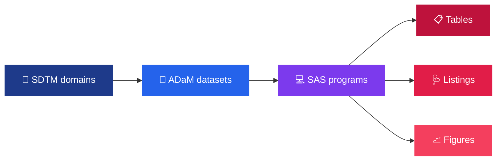

 

## 🔬 Intralesional Immunotherapy with Active Drug Vaccine in Patients with Advanced Merkel Cell Carcinoma or Cutaneous Squamous Cell Carcinoma

**SAS programs for Tables, Listings and Figures (TLFs) in a Phase 1 oncology study.**

🎗️ 🧬 🔬 💉 🩺 📊

---

## 📌 Project Overview

This portfolio project uses **SAS 9.4** to analyse clinical trial data and produce **Tables, Listings and Figures (TLFs)** for a Phase 1 oncology immunotherapy study. The study evaluates an active drug vaccine in patients with advanced **Merkel Cell Carcinoma (MCC)** or **Cutaneous Squamous Cell Carcinoma (cSCC)**.

---

## 🧾 Study at a Glance

| | |
|---|---|
| 🧪 **Phase** | Phase 1 |
| 🎗️ **Indication** | Advanced Merkel Cell Carcinoma (MCC) or Cutaneous Squamous Cell Carcinoma (cSCC) |
| 💉 **Intervention** | Intralesional immunotherapy with an active drug vaccine |
| 🧬 **Data standards** | CDISC SDTM and ADaM |
| 💻 **Software** | SAS Studio, Base SAS 9.4_M8 |
| 📊 **Deliverables** | Tables, Listings and Figures |

---

## 🔄 Workflow

---

## ⭐ Main Concepts Highlighted

<table>
<tr>
<td width="50%">

### 💻 SAS programming
- **Data Step**
- **PROC SUMMARY** and **PROC FREQ** for summaries
- **PROC TRANSPOSE** for reshaping data
- **ODS RTF** and **PROC REPORT** for production-style tables and listings

</td>
<td width="50%">

### 🧬 Clinical analysis
- **Survival analysis** with **PROC LIFETEST** for PFS and OS
- **RECIST 1.1** best overall response
- **TEAE** safety summaries
- **CDISC ADaM** analysis datasets

</td>
</tr>
</table>

| Concept | Where it is used |
|---------|------------------|
| 📉 **Kaplan-Meier plots** | Progression-free survival and overall survival (`ADTTE`) |
| 🌊 **Waterfall plots** | Tumour assessment and target lesion measurements |
| ⚠️ **TEAE tables** | Safety profile from adverse events (`ADAE`) |
| 🧪 **Lab toxicity grades** | Hematology and chemistry shifts (`ADLB`) |
| 🎗️ **Best overall response** | Response by RECIST 1.1 (`ADRS`) |

---

## 👩‍💻 Project Information

| | |
|---|---|
| **Author** | Ansania Salam |
| **Domain** | Clinical Research · Clinical Data Analysis · Biostatistics · Oncology |
| **Key SAS tools** | SAS Studio, Base SAS 9.4_M8, ODS RTF, PROC REPORT, PROC LIFETEST, PROC SGPLOT, PROC FREQ, PROC SUMMARY |
| **Status** | ✅ Completed |

---

## 📊 CDISC Standards & Input Datasets

The analysis uses CDISC-compliant **ADaM (Analysis Data Model)** datasets derived from raw SDTM domains.

| Dataset | Description | Analytical Focus |
|:--------|:------------|:-----------------|
| **`ADSL`** | Subject Level Analysis Dataset | Demographics, treatment arm assignments and population counts |
| **`ADAE`** | Adverse Events Analysis Dataset | Treatment-emergent adverse events (TEAEs) and safety profile |
| **`ADLB`** | Laboratory Results Analysis Dataset | Hematology, chemistry and toxicity grade changes |
| **`ADVS`** | Vital Signs Analysis Dataset | Baseline and post-baseline vital signs |
| **`ADRS`** | Response Analysis Dataset | Best overall response (RECIST 1.1) and tumour assessment |
| **`ADTTE`** | Time-to-Event Analysis Dataset | Progression-free survival (PFS) and overall survival (OS) |
| **`ADEFF`** | Efficacy Analysis Dataset | Secondary efficacy endpoints and target lesion measurements |

> 🔒 **Note:** Following clinical confidentiality standards, raw participant-level datasets are not included in this repository.

---

## 📂 Repository Structure

| Folder / File | What's inside |
|---------------|---------------|
| 📁 [01_Tables/](./01_Tables/) | SAS programs for tables (demographics, AE, lab, efficacy) |
| 📁 [02_Listings/](./02_Listings/) | SAS programs for patient listings |
| 📁 [03_Figures/](./03_Figures/) | SAS programs for figures (Kaplan-Meier, waterfall plots) |
| 📁 [04_OUTPUTS/](./04_OUTPUTS/) | Generated outputs approved for public sharing |
| &nbsp;&nbsp;&nbsp;↳ 📄 [01_Tables/](./04_OUTPUTS/01_Tables/) | Formatted RTF/PDF table outputs |
| &nbsp;&nbsp;&nbsp;↳ 📄 [02_Listings/](./04_OUTPUTS/02_Listings/) | Formatted patient listings |
| &nbsp;&nbsp;&nbsp;↳ 🖼️ [03_Figures/](./04_OUTPUTS/03_Figures/) | High-resolution clinical graphics and plots |
| 🎗️ [assets/](./assets/) | Project logo |
| ⚖️ [LICENSE](./LICENSE) | MIT License terms |

---

## 🎯 Skills Shown in This Project

| Area | What it covers |
|------|----------------|
| **SAS programming** | Data Step, PROC SUMMARY, PROC FREQ, PROC TRANSPOSE |
| **Reporting** | ODS RTF, PROC REPORT for production-style tables and listings |
| **Graphics** | PROC SGPLOT figures, including Kaplan-Meier and waterfall plots |
| **Survival analysis** | PROC LIFETEST for PFS and OS |
| **Clinical standards** | CDISC ADaM datasets, RECIST 1.1 response, TEAE safety summaries |

---

## 🛠️ Tools & SAS Execution Environment

| | |
|---|---|
| **Environment** | SAS Studio / Base SAS 9.4_M8 |
| **Reporting & graphics** | ODS RTF, PROC REPORT, PROC SGPLOT, PROC LIFETEST |
| **Data manipulation** | Base SAS Data Step, PROC SUMMARY, PROC FREQ, PROC TRANSPOSE |

### ⚙️ Execution Requirements

The programs need the matching input ADaM datasets and may need path updates to run in another SAS environment. Because the input datasets are not included, the programs cannot be run from this repository alone.

---

## 🔒 Confidentiality & Compliance

This repository contains SAS code and selected outputs developed for biostatistical training and portfolio presentation. No real patient data or unmasked protected health information (PHI) is hosted here.

---

## 👤 Author

  <b>Ansania Salam</b>  
  

---

## ⚖️ License

This project is licensed under the **MIT License**. See the [LICENSE](./LICENSE) file for details.

